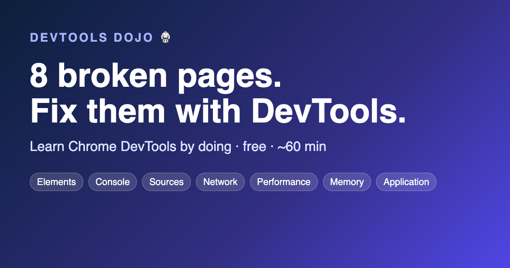
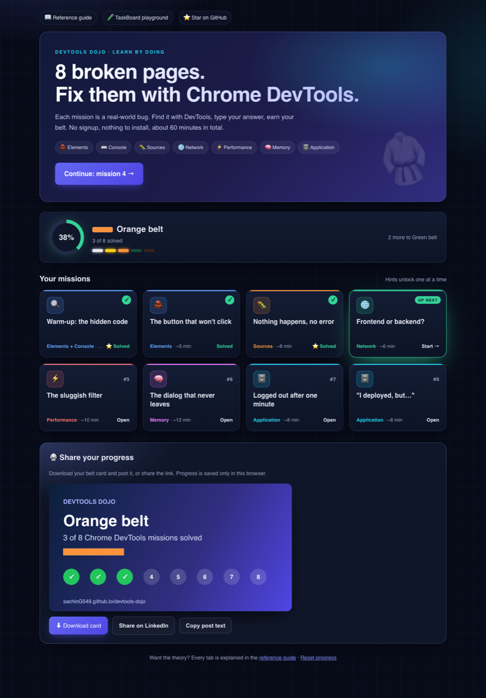
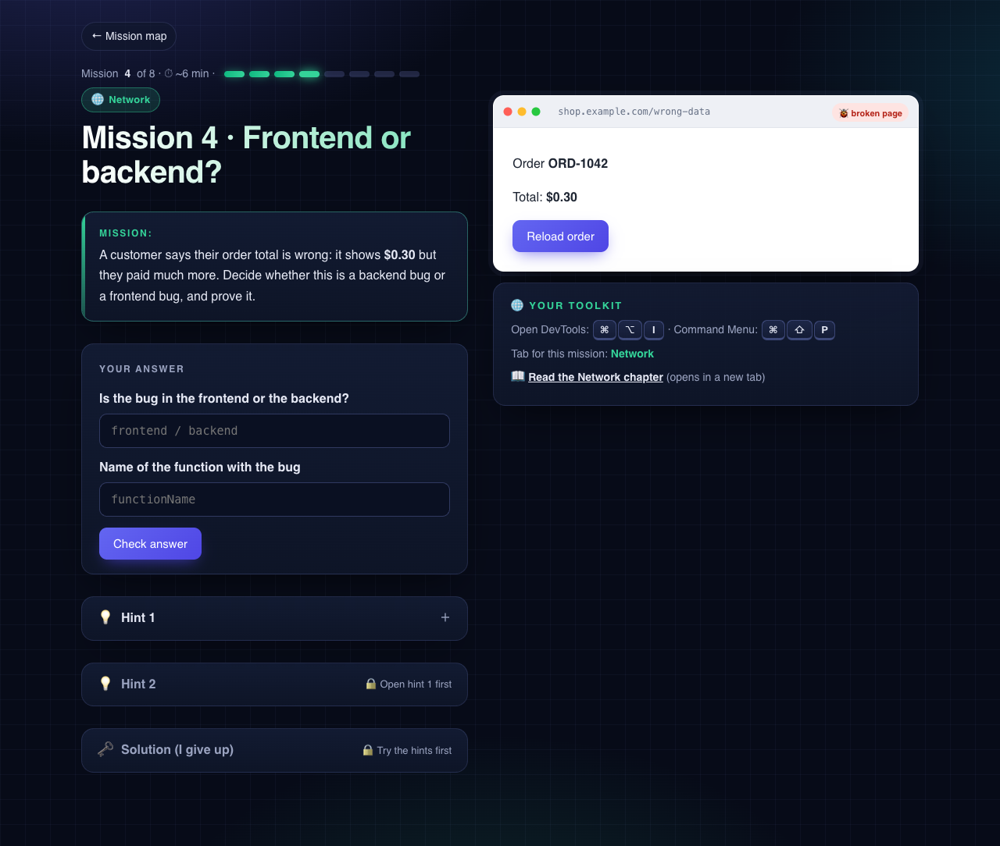
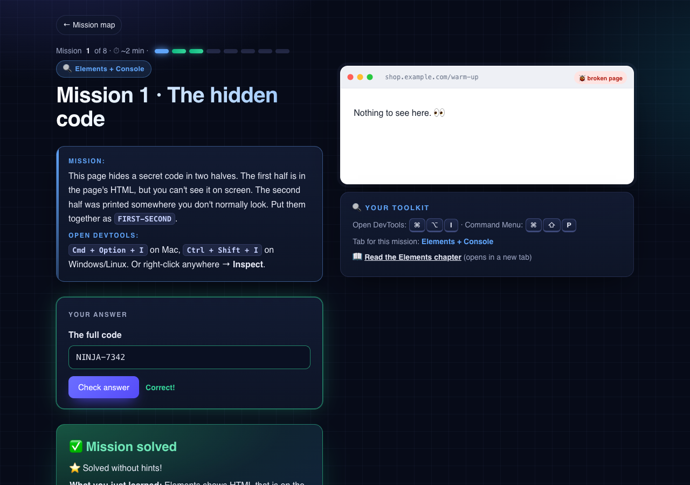

# DevTools Dojo 🥋

**8 broken pages. Fix them with Chrome DevTools.**

Learn DevTools by doing: each mission is a small web page with one real-world bug. Find it with DevTools, type your answer, earn your belt. Free, nothing to install, about 60 minutes. A complete reference guide explains every tab and option when you want the theory.

### ▶️ [Start mission 1](https://sachinG549.github.io/devtools-dojo/labs/00-warm-up/) · [Mission map](https://sachinG549.github.io/devtools-dojo/labs/) · [Reference guide](https://sachinG549.github.io/devtools-dojo/) · [PDF](https://github.com/sachinG549/devtools-dojo/releases/latest)



| # | Mission | Tab | Time |
|---|---|---|---|
| 1 | The hidden code | Elements + Console | 2 min |
| 2 | The button that won't click | Elements | 5 min |
| 3 | Nothing happens, no error | Sources | 8 min |
| 4 | Frontend or backend? | Network | 6 min |
| 5 | The sluggish filter | Performance | 10 min |
| 6 | The dialog that never leaves | Memory | 12 min |
| 7 | Logged out after one minute | Application | 8 min |
| 8 | "I deployed, but…" | Application | 8 min |

Answers are checked on the page, hints unlock one at a time, and progress is saved in your browser (no account, no tracking).

| Mission map | A mission | Solved |
|---|---|---|
|  |  |  |

## Who it's for

Developers, QA engineers and support engineers who open DevTools every day but only use Elements and a bit of Network. By the end you'll know which tab answers which question, and you'll be able to teach it.

## What's inside

| Part | Content |
|---|---|
| [Basics](docs/00-basics.md) | Top bar, Command Menu, drawer, settings worth turning on |
| Panels | [Elements](docs/01-elements.md) · [Console](docs/02-console.md) · [Sources](docs/03-sources.md) · [Network](docs/04-network.md) · [Performance](docs/05-performance.md) · [Memory](docs/06-memory.md) · [Application](docs/07-application.md) · [Security](docs/08-security.md) · [Lighthouse](docs/09-lighthouse.md) · [Recorder](docs/10-recorder.md) · [Extensions](docs/11-extensions.md) · [More tools](docs/12-more-tools.md) |
| Daily use | [Shortcuts](docs/13-shortcuts.md) · [Debugging playbooks](docs/14-playbooks.md) |
| Practice | [Missions](labs/) · [2-week plan](docs/15-practice-plan.md) |
| Teaching | [How to teach this to others](docs/16-teaching.md) |

## The mental model

| Tab | Question it answers |
|---|---|
| Elements | What is on the page right now? |
| Console | What is the page saying? Run JS inside it |
| Sources | What is the code doing, line by line? |
| Network | What did the page ask the server, and what came back? |
| Performance | What was the browser busy doing? |
| Memory | What is the page holding on to? |
| Application | What did the site store on my machine? |
| Security | Can this connection be trusted? |
| Lighthouse | Automated report card |
| Recorder | Record, replay and export user steps |

## Run it locally

```bash
# Labs: any static server works
python3 -m http.server 8000      # then open http://localhost:8000/labs/

# Docs site
pip install -r requirements.txt
mkdocs serve                     # http://127.0.0.1:8000

# PDF (needs pandoc and Google Chrome)
./pdf/build.sh                   # writes dist/DevTools-Dojo.pdf
```

## Contributing

DevTools changes every Chrome release, so corrections are very welcome. See [CONTRIBUTING.md](CONTRIBUTING.md). Ideas for new labs are especially useful.

## License

- Guide text: [CC BY 4.0](LICENSE-CONTENT). Reuse and teach from it, with credit.
- Lab and build code: [MIT](LICENSE).

Not affiliated with Google. Chrome is a trademark of Google LLC.
