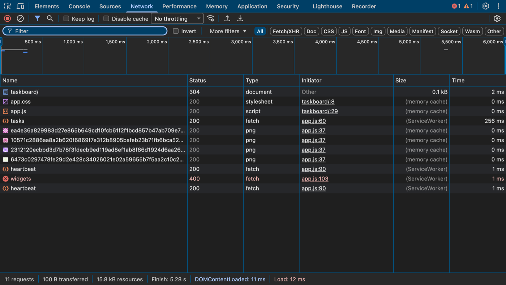

# 4. Network

!!! example "Try it now: a 5-minute mission"
    A customer paid $30 but the page shows $0.30. Is the bug in the frontend or the backend?

    [Start the mission →](https://sachinG549.github.io/devtools-dojo/labs/03-wrong-data/){ .md-button .md-button--primary target=_blank }

{ loading=lazy }

*Screenshot: the real panel, open on [TaskBoard](https://sachinG549.github.io/devtools-dojo/labs/taskboard/){target=_blank}. Open it in another window and follow along.*

### What it is

A log of every HTTP request the page makes: HTML, JS, CSS, images, fonts, API calls (fetch/XHR), WebSockets, with full headers, bodies and timings.

### Why it exists / problems it solves

- "The UI shows wrong data": was it the API's fault (wrong response) or the frontend's (right response, wrong rendering)? Network answers this in 10 seconds. **This is the most useful debugging split you can teach.**
- "The page is slow": which request is slow, and which phase (DNS? server? download?).
- "Login fails / I'm logged out": check cookies sent/received, redirects, `401/403`.
- "CORS error": see the preflight `OPTIONS` request and missing headers.
- "My change isn't showing": is the file served from cache?
- Reproduce a call outside the browser: **Copy as cURL**.

### Toolbar

| Control | Meaning |
|---|---|
| 🔴 Record | Recording on (red). Click to stop logging requests |
| ⊘ Clear | Clear the list (`Cmd + K`) |
| Filter funnel | Show/hide the filter row |
| 🔍 Search | Opens the **Search** pane (it opens on the left). Searches **headers and bodies** of all requests. Find "which request returned this ticket ID?" |
| **Keep log** (Preserve log) | Don't clear on reload/navigation. Needed for login flows and redirects |
| **Disable cache** ✅ | Bypass HTTP cache while DevTools is open. Ticking it is right for development, but remember real users *do* have cache |
| **No throttling ▾** | Simulate slow networks: Fast 4G, Slow 4G, 3G, **Offline**, or custom profiles |
| Wi-Fi-with-gear icon | **Network conditions**: change **User agent** (pretend to be iPhone/Googlebot), accepted encodings, throttling |
| ⬆ / ⬇ | **Import / Export HAR**. A HAR file is a recording of all requests. Ask users/customers to send one when reporting bugs. **HAR files can contain cookies and tokens; Chrome exports a sanitized version by default, and only share the "with sensitive data" version with trusted people** |
| ⚙ (right) | Settings: **Big request rows**, **Show overview**, **Group by frame**, **Capture screenshots** (filmstrip of the page as it loads) |

### Filter row

Type chips: **All, Fetch/XHR, Doc, CSS, JS, Font, Img, Media, Manifest, Socket (WebSocket), Wasm, Other**. `Cmd + click` to pick several. For API debugging, use **Fetch/XHR**.

**Invert** checkbox: show everything that does *not* match the filter.

**More filters ▾**: Hide data URLs, Hide extension URLs (hide ad-blocker and other extension noise), Blocked response cookies, Blocked requests, 3rd-party requests.

The text filter supports **properties**. These are worth memorising:

??? info "Reference table (12 rows), click to expand"
    | Filter | Example |
    |---|---|
    | Plain text / regex | `heartbeat`, `/rest\/api\/\d/` |
    | Exclude | `-heartbeat` (hide the polling noise) |
    | `status-code:` | `status-code:400`, `status-code:500` |
    | `method:` | `method:POST` |
    | `domain:` | `domain:*.example.com` |
    | `larger-than:` | `larger-than:500k` |
    | `mime-type:` | `mime-type:application/json` |
    | `is:` | `is:running`, `is:from-cache` |
    | `has-response-header:` | `has-response-header:set-cookie` |
    | `set-cookie-name:` / `cookie-name:` | find who sets or sends a cookie |
    | `scheme:` | `scheme:http` (find insecure calls) |
    | `priority:` | `priority:High` |

Combine with spaces (AND).

### Overview (timeline strip)

The bars at the top (`50 ms … 400 ms`) show when requests happened. Drag across it to filter to that time window. Blue vertical line = `DOMContentLoaded`, red = `load`.

### Request table columns

Default: **Name, Status, Type, Initiator, Size, Time, Waterfall**. Right-click a header to add **Method, Domain, Protocol (h2/h3), Scheme, Remote address, Priority, Cookies, Set-Cookies, Response headers (custom)**.

- **Name**: last part of the URL. A `heartbeat` row repeating every few seconds is a polling call apps make to keep the session alive / check for updates.
- **Status**: `200` OK. Learn these groups:
  - `2xx` success (`200` OK, `201` Created, `204` No Content)
  - `3xx` redirect / cache (`301`, `302`, `304 Not Modified` = cached copy reused)
  - `4xx` **client** problem (`400` bad request body/params, `401` not logged in, `403` no permission, `404` not found, `409` conflict, `422` validation, `429` rate limited)
  - `5xx` **server** problem (`500`, `502` bad gateway, `503` unavailable, `504` timeout)
  - `(failed)`, `(blocked:...)`, `(canceled)`, `CORS error` = never reached a normal response
- **Type**: fetch, xhr, document, script, stylesheet, preflight...
- **Initiator**: what triggered it. `index.ts:20` means line 20 of `index.ts` called `fetch`. Click to jump. **Hold `Shift` and hover a row**: initiators turn green, requests it caused turn red.
- **Size**: transferred size / resource size. Shows `(memory cache)`, `(disk cache)`, `(ServiceWorker)` when cached.
- **Time** and **Waterfall**: duration and a bar showing phases.

### Click a request: the detail tabs

- **Headers**
  - *General*: URL, method, status, remote address, **Referrer Policy**.
  - *Response Headers*: `content-type`, `cache-control`, `set-cookie`, `access-control-allow-origin` (CORS), `content-security-policy`.
  - *Request Headers*: `cookie`, `authorization`, `origin`, `user-agent`, `accept`.
  - Toggle **Raw** to see the exact text.
- **Payload**: query string params and request body (form data or JSON). Check what the frontend actually sent. This is where you'd diagnose a `400` error from the Console.
- **Preview**: formatted response (JSON tree, rendered image/HTML).
- **Response**: raw response body. `{}` to pretty print.
- **Initiator**: full call stack and the chain of requests that led to this one.
- **Timing**: phase breakdown:
  - *Queueing / Stalled*: waiting for a free connection or higher-priority requests. (HTTP/1.1 allows ~6 connections per host.)
  - *DNS Lookup*: domain → IP.
  - *Initial connection* + *SSL*: TCP and TLS handshake.
  - *Request sent*.
  - **Waiting for server response (TTFB)**: the server's think time. Large = backend is slow.
  - *Content Download*: large = response too big or slow network.
- **Cookies**: cookies sent and received, with reasons if blocked (SameSite, Secure, domain mismatch).
- **Messages** (WebSockets) / **EventStream** (Server-Sent Events): each message in real time.

### Right-click a request: power actions

- **Copy → Copy as cURL**: paste into terminal or Postman (import cURL) to reproduce exactly, including cookies. Also **Copy as fetch**, **Copy as Node.js fetch**, **Copy response**, **Copy URL**, **Copy all as HAR**.
- **Replay XHR**: resend the request.
- **Override content / Override headers**: mock it (see Sources → Overrides).
- **Block request URL / Block request domain**: test how the page behaves if an API or third-party script fails.
- **Open in Sources panel**, **Open in new tab**.
- **Clear browser cache / cookies**.

### Practice

1. Filter `-heartbeat` and type `method:POST`, then move a TaskBoard card. Find the request that saved it; check its Payload and Response.
2. Copy that request as cURL and run it in Terminal.
3. Set throttling to **Slow 4G**, reload, watch the waterfall.
4. Block `www.gravatar.com` (Block request domain) and reload TaskBoard. Avatars break; nothing else should.
5. Search pane: search a task key like `TB-` to find which response contained it.
