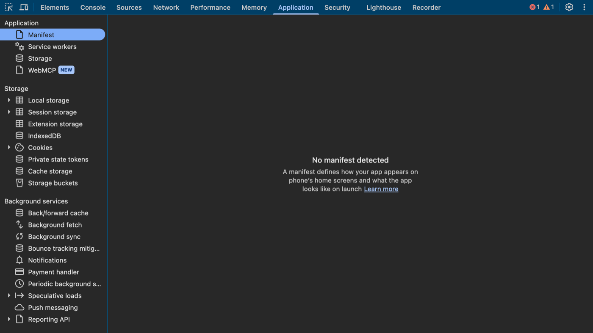

# 7. Application

!!! example "Try it now: a 5-minute mission"
    Users get logged out after one minute. The answer is in what the site stores.

    [Start the mission →](https://sachinG549.github.io/devtools-dojo/labs/06-cookie-logout/){ .md-button .md-button--primary target=_blank }

{ loading=lazy }

*Screenshot: the real panel, open on [TaskBoard](https://sachinG549.github.io/devtools-dojo/labs/taskboard/){target=_blank}. Open it in another window and follow along.*

### What it is

Everything the site **stores** in your browser, plus "app-like" features (PWA manifest, service workers, background services) and per-frame security info.

### Why it exists / problems it solves

- "I'm logged in on one tab but not another" / "logout doesn't work" → Cookies.
- "Old data still shows after a fix" → Local storage / IndexedDB / Cache storage / Service worker serving stale files.
- "Reset to a clean state like a new user" → **Storage → Clear site data**.
- Read and edit tokens, feature flags, user preferences that the app stores client-side.

### Left sidebar, section by section

#### Application

- **Manifest**: the PWA `manifest.json`: name, icons, theme colour, start URL, installability errors.
- **Service workers**: background scripts that can intercept network requests and cache files (offline support, push). Options:
  - **Offline**: simulate no network.
  - **Update on reload**: always install the newest service worker. Turn on during development, or you'll be debugging old code.
  - **Bypass for network**: ignore the service worker and go to network.
  - **Update / Unregister / Push / Sync** buttons; status (activated, waiting).
  - Classic bug: "my deploy isn't showing" → a service worker is serving cached files.
- **Storage**: usage chart per storage type, **Clear site data** (with checkboxes for what to clear: cookies, storage, cache, service workers), and **Simulate custom storage quota**.
- **WebMCP** (marked NEW): a very new, experimental area related to pages exposing "tools" to AI agents (the WebMCP proposal). Most sites won't use it yet.
- **Ads** (flask icon = experimental): inspection of ad-related browser features (e.g. Privacy Sandbox ad APIs). Rarely needed outside ad-tech.

#### Storage

| Storage | Lifetime | Size | Notes |
|---|---|---|---|
| **Local storage** | Forever, until cleared | ~5–10 MB per origin | Key/value strings. Apps store settings, flags, sometimes tokens. Double-click to edit; right-click to delete |
| **Session storage** | Until the tab closes | ~5 MB | Per tab. A new tab = empty |
| **Extension storage** | Extension-controlled | | Data stored by extensions |
| **IndexedDB** | Forever | Large (GBs, based on disk) | Real database in the browser. Big apps cache data here, which is why Lighthouse sometimes warns that IndexedDB data affects scores. You can browse object stores, delete entries, refresh |
| **Cookies** | Per `Expires`/`Max-Age`, or session | ~4 KB each | Sent with every request to the matching domain |
| **Private state tokens** | | | Anti-fraud tokens (Privacy Sandbox), replacement for some fingerprinting |
| **Cache storage** | Forever | Large | Used by service workers to cache responses. Right-click to delete |
| **Storage buckets** | | | Newer API grouping storage with its own eviction policy |

**Cookies view columns** (learn these, they explain most auth bugs):

- **Name / Value**
- **Domain / Path**: where it's sent. `.example.com` means all subdomains.
- **Expires / Max-Age**: `Session` = deleted when browser closes.
- **Size**
- **HttpOnly** ✓: JavaScript can't read it (`document.cookie` won't show it). Protects session cookies from XSS.
- **Secure** ✓: only sent over HTTPS.
- **SameSite**: `Strict` / `Lax` / `None`. Controls whether it's sent on cross-site requests. `None` requires `Secure`. Embedded iframes and SSO breaking is often a SameSite problem.
- **Partition Key** (CHIPS): third-party cookie that is isolated per top-level site.
- **Priority**.

Filter box at the top, **Only show cookies with an issue** checkbox, and a pane at the bottom that decodes the selected value. Double-click to edit; select + `Delete` to remove one; ⊘ to clear all. Deleting the session cookie is the fastest way to test "what happens when the session expires".

#### Background services

Each one has a **Record** button that logs events for 3 days even when DevTools is closed.

- **Back/forward cache**: "Test back/forward cache" button tells you whether instant back-button navigation works, and **why not** (e.g. the `unload` handler you saw in Console blocks it).
- **Background fetch / Background sync / Periodic background sync**: service worker tasks that run after the page closes or on a schedule.
- **Bounce tracking mitigations**: Chrome deleting state for sites that only redirect users for tracking.
- **Notifications / Push messaging**: debug web push.
- **Payment handler**: Payment Request API events.
- **Speculative loads**: **prefetch / prerender** rules (Speculation Rules API) and whether they succeeded. Used for "instant" navigation.
- **Reporting API**: reports sent by the browser (CSP violations, deprecations, crashes) to endpoints like `report-to: csp-default-endpoint`.
- **Device bound sessions**: newer feature that ties session cookies to a device key so stolen cookies don't work elsewhere.

#### Frames

`top` and each iframe. Selecting `top` shows:

- **Document**: URL, Origin, owner element.
- **Security & isolation**:
  - *Secure context: Yes* → HTTPS, so powerful APIs (clipboard, geolocation, service workers) are allowed.
  - *Cross-origin isolated: No* → `SharedArrayBuffer` and high-precision timers are unavailable (shown in "API availability"). Requires **COOP** `same-origin` and **COEP** `require-corp` headers.
  - *COEP: none, COOP: unsafe-none* → no isolation headers set.
- **Content Security Policy (CSP)**: rules the server sends saying where content may load from.
  - `frame-ancestors 'self' *.example.com partner.example.org` → only these sites may embed the page in an iframe (protects against clickjacking).
  - `report-uri` / `report-to` → where violations are reported.
  - **Content-Security-Policy-Report-Only** → `script-src`, `img-src`, `style-src` rules that are **monitored but not enforced**. A safe way to roll out a stricter policy.
  - `'unsafe-inline'` / `'unsafe-eval'` → weaker settings allowing inline scripts and `eval`.
- Expand a frame to see its scripts, stylesheets, images, and workers.

### Practice

1. Cookies: find `HttpOnly` cookies, then run `document.cookie` in Console. Notice they're missing.
2. Local storage: find a key on any site you use (or TaskBoard's `tb:filters`), change it, reload, see if anything changes.
3. Storage → Clear site data on a test site, reload: you're a brand-new visitor.
4. Back/forward cache → Test. Read why it fails.
