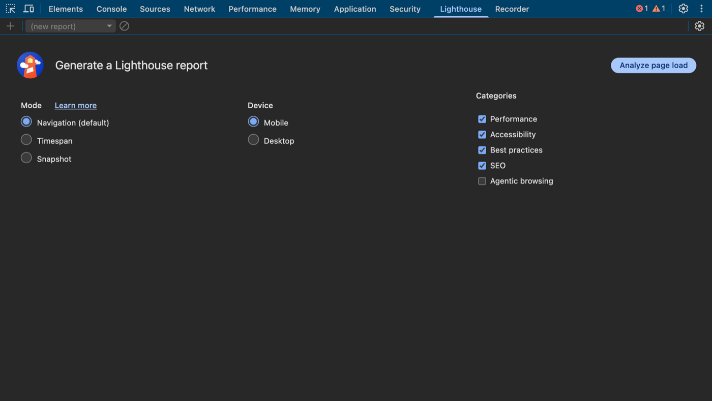

# 9. Lighthouse

{ loading=lazy }

*Screenshot: the real panel, open on [TaskBoard](https://sachinG549.github.io/devtools-dojo/labs/taskboard/){target=_blank}. Open it in another window and follow along.*

### What it is

An automated **audit** that scores a page 0–100 on Performance, Accessibility, Best Practices and SEO, and tells you exactly what to fix.

### Why it exists / problems it solves

- A repeatable, shareable report for "is this page good?"
- Catches things humans miss: missing alt text, low colour contrast, unoptimised images, render-blocking scripts, missing meta tags, deprecated APIs, console errors.
- Can run in CI (Lighthouse CLI / PageSpeed Insights) to stop regressions.

### Options

**Mode**:
- **Navigation (default)**: reloads the page and audits the **load**. Gives the full Performance score.
- **Timespan**: you start it, interact (open dialogs, scroll), stop it. Audits **runtime** behaviour like INP and layout shifts during interaction. No single perf score.
- **Snapshot**: audits the page **as it is right now** (e.g. with a modal open) without reloading. Good for accessibility of states.

**Device**: Mobile (simulated mid-range phone + slow 4G throttling) or Desktop. Mobile scores are usually much lower; that's expected.

**Categories**:
- **Performance**: FCP, LCP, TBT (Total Blocking Time, the lab stand-in for INP), CLS, Speed Index.
- **Accessibility**: automated a11y checks (catches roughly a third of real issues; still test manually with a keyboard and screen reader).
- **Best practices**: HTTPS, console errors, deprecated APIs, image aspect ratios, CSP.
- **SEO**: title, meta description, crawlability, link text, viewport.
- **Agentic browsing** (newest, unticked by default): checks how well the page works for AI agents navigating it. It's new; treat its results as guidance.

The orange warning **"stored data affecting loading performance: IndexedDB. Audit in an incognito window"**: cached data makes the run unrealistic. For accurate scores:
- Use an **Incognito** window (also disables most extensions like Adblock Plus, which otherwise skew results).
- Close other heavy tabs.
- Run 3 times and take the median; scores vary ±5–10 points.

**⚙ (gear)**: simulated vs DevTools throttling, clear storage on/off.

### Reading the report

- Score gauges (0–49 red, 50–89 orange, 90–100 green).
- **Metrics** with values.
- **View Trace** opens it in the Performance panel.
- **Insights / Diagnostics**: each item expands to show the exact elements, URLs and estimated savings.
- **Passed audits** and **Not applicable** sections.
- Export with `⋮` → Save as HTML/JSON, or open in Lighthouse Viewer.
- **Lab vs field**: Lighthouse is a single lab run on your machine. Real-user ("field") data comes from CrUX / the Live metrics panel. Use both.
